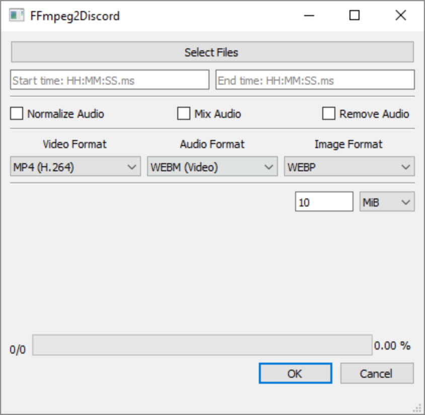

### FFmpeg2Discord

Frustrated by manually using ffmpeg to compress videos to get around Discord's 10 MiB file size limit, I wrote a simple graphical Python program to automate the process. This program works for both Windows and Linux systems.

    

### Warning

This program is very CPU intensive and on my i7 8086k it took about 3 minutes to compress a 1 minute 1080p 60 FPS video.

### Features

- 100% offline, opensource and private
- Ability to compress videos, images and audio
- Set desired file size in MiB or MB (Default 10 MiB)
- Pick your output format: MP4 (H.264), WEBM (VP9) or WEBM (AV1) for video, WEBM or OGG for audio, WEBP or JPG for images
- Trim videos and audio
- Remove audio
- Mix audio tracks (useful if you record your gameplay and mic audio separately)
- Normalize audio to a consistent level of volume
- Two-pass encoding that automatically scales down resolution and framerate to hit the target file size while mantaining optimal quality
- Tries lossless compression first (jpegoptim for JPGs, lossless WebP) before falling back to re-encoding
- Removes metadata
- Batch processing

### Install

The easiest way to get up and running on Linux is to head over to the releases section and download the AppImage. After that all you need to do is double click it.

Alternatively you can install the dependencies and run the Python script.

To do so, install FFmpeg (with ffprobe) and jpegoptim to your system's path.

Then:
`pip install -r requirements.txt`

And run:
`python src/FFmpeg2Discord.py`

### Build binaries

You can build a Windows binary with `scripts/build-windows.bat`. It creates a virtualenv, installs `requirements.txt` and runs PyInstaller to produce a `FFmpeg2Discord.exe` that expects `ffmpeg.exe` and `jpegoptim.exe` to already be on your PATH.

On Linux, `scripts/build-appimage.sh` produces a self contained AppImage: it compiles FFmpeg, ffprobe and SVT-AV1 from source with `scripts/build-deps.sh` (or reuses a prebuilt `tools/` tree), copies jpegoptim from your PATH, bundles everything with the codec libraries it needs and packs it with `appimagetool`. This is also what CI uses to produce the release artifact.

`scripts/build-deps.sh` can also be run on its own to build just the command line tools into a `tools/` directory, which the program picks up before falling back to your system's PATH.

### License

Distributed under the GNU Affero General Public License v3.0. See [LICENSE.md](LICENSE.md) for details.
